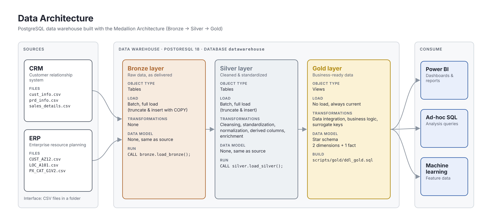
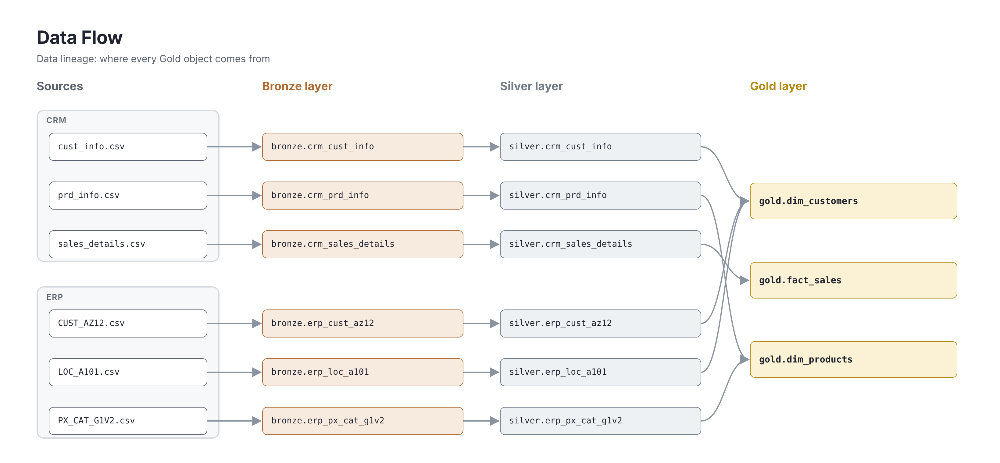
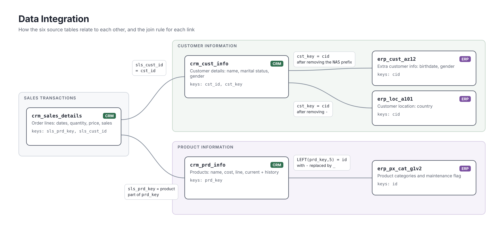
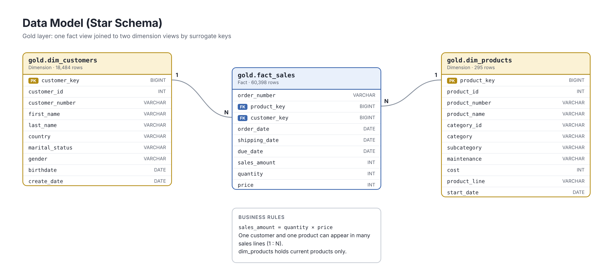

# Data Warehouse in PostgreSQL

A modern data warehouse built in **PostgreSQL** with the **Medallion Architecture** (Bronze, Silver, Gold). It takes raw CRM and ERP exports, cleans and integrates them with SQL, and delivers a star schema that is ready for analytics and Power BI.

Based on the *SQL Data Warehouse* project by Data With Baraa (originally SQL Server), re-implemented in PostgreSQL with stored procedures, load logging and error handling.

---

## Data Architecture



| Layer  | Purpose                         | Object type | Load                          |
|--------|---------------------------------|-------------|-------------------------------|
| Bronze | raw data, exactly as delivered  | tables      | full load with `COPY`         |
| Silver | cleaned, standardized data      | tables      | full load from Bronze         |
| Gold   | business-ready star schema      | views       | none, always current          |

## Project Requirements

**Goal:** consolidate sales data from two source systems into one warehouse for analytical reporting.

- **Sources:** CRM and ERP, delivered as six CSV files.
- **Data quality:** fix data quality issues before analysis.
- **Integration:** combine both sources into one user-friendly data model.
- **Scope:** latest dataset only, no history (no slowly changing dimensions).
- **Documentation:** clear documentation of the model for business and analytics users.

## Data Flow



## Data Integration



## Data Model



| Object               | Type      | Rows   |
|----------------------|-----------|--------|
| `gold.dim_customers` | dimension | 18,484 |
| `gold.dim_products`  | dimension | 295    |
| `gold.fact_sales`    | fact      | 60,398 |

Full column descriptions: [docs/data_catalog.md](docs/data_catalog.md)

---

## Data Cleaning in the Silver Layer

| Table               | What was fixed |
|---------------------|----------------|
| `crm_cust_info`     | duplicate customer IDs (kept the latest record), leading/trailing spaces, codes `M`/`S`/`F` turned into readable values |
| `crm_prd_info`      | product key split into category ID and product key, missing cost set to 0, product line codes decoded, end dates rebuilt with `LEAD()` so versions never overlap |
| `crm_sales_details` | integer dates (`20101229`) converted to `DATE`, invalid dates set to NULL, wrong or missing sales and price recalculated (`sales = quantity × price`) |
| `erp_cust_az12`     | `NAS` prefix removed from IDs, future birthdates set to NULL, gender values unified |
| `erp_loc_a101`      | `-` removed from IDs, country codes standardized (`DE` → Germany, `US`/`USA` → United States, blanks → `n/a`) |

Every rule is verified by the scripts in [`tests/`](tests).

---

## How to Run

**Requirements:** PostgreSQL (tested on PostgreSQL 18) and pgAdmin 4 or psql.

1. **Create the database and schemas** with [`scripts/init_database.sql`](scripts/init_database.sql). Part 1 runs on the `postgres` database, part 2 on `datawarehouse`.
2. **Put the CSV files where PostgreSQL can read them.** `COPY` reads files as the PostgreSQL server, which on Windows usually cannot access your Desktop. Copy the `datasets` folder to `C:\Users\Public\dwh_datasets` (or pass your own path in step 4).
3. **Create the objects** (in the `datawarehouse` database, in this order):
   - `scripts/bronze/ddl_bronze.sql`
   - `scripts/bronze/proc_load_bronze.sql`
   - `scripts/silver/ddl_silver.sql`
   - `scripts/silver/proc_load_silver.sql`
4. **Load the data:**
   ```sql
   CALL bronze.load_bronze();          -- or CALL bronze.load_bronze('D:/my/path/datasets');
   CALL silver.load_silver();
   ```
5. **Create the Gold views** with `scripts/gold/ddl_gold.sql`.
6. **Check the result** with `tests/quality_checks_silver.sql` and `tests/quality_checks_gold.sql`.

```sql
SELECT * FROM gold.fact_sales LIMIT 10;
```

---

## Repository Structure

```
postgresql-data-warehouse/
├── datasets/                      # raw CRM and ERP CSV files
│   ├── source_crm/
│   └── source_erp/
├── docs/
│   ├── data_architecture.png
│   ├── data_flow.png
│   ├── data_integration.png
│   ├── data_model.png
│   ├── data_catalog.md            # Gold layer column descriptions
│   └── naming_conventions.md
├── scripts/
│   ├── init_database.sql
│   ├── bronze/                    # DDL + load procedure
│   ├── silver/                    # DDL + cleaning procedure
│   └── gold/                      # star schema views
├── tests/
│   ├── quality_checks_silver.sql
│   └── quality_checks_gold.sql
├── LICENSE
└── README.md
```

## Tech Stack

PostgreSQL 18 · PL/pgSQL · pgAdmin 4 · Git / GitHub

## About Me

**Rama Almoujahed**, M.Sc. student in Business Informatics at FH Südwestfalen, Germany, focused on data analytics and business intelligence (SQL, Power BI, Python).

## License

MIT License, see [LICENSE](LICENSE).
